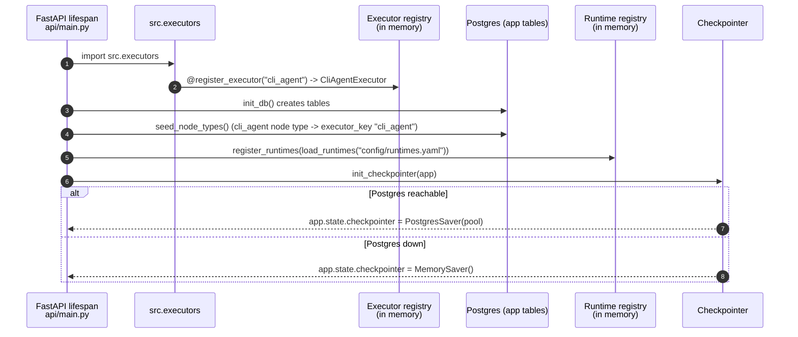
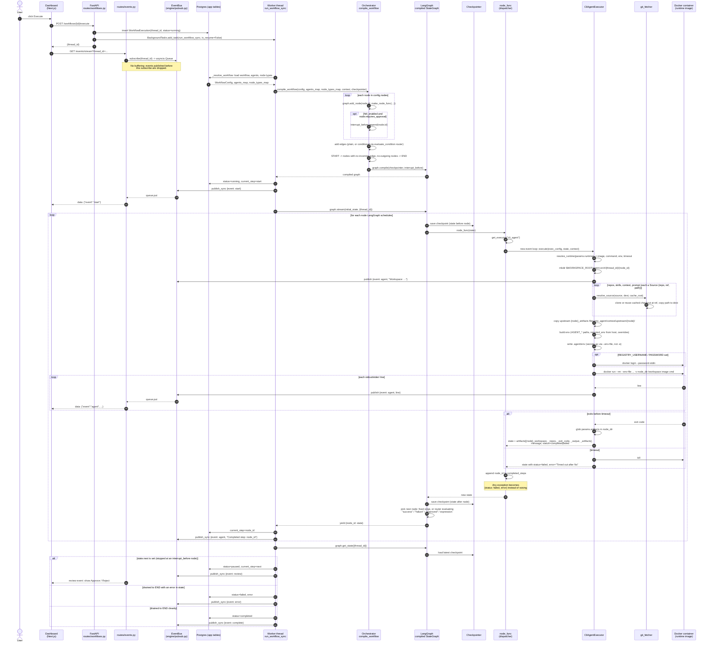
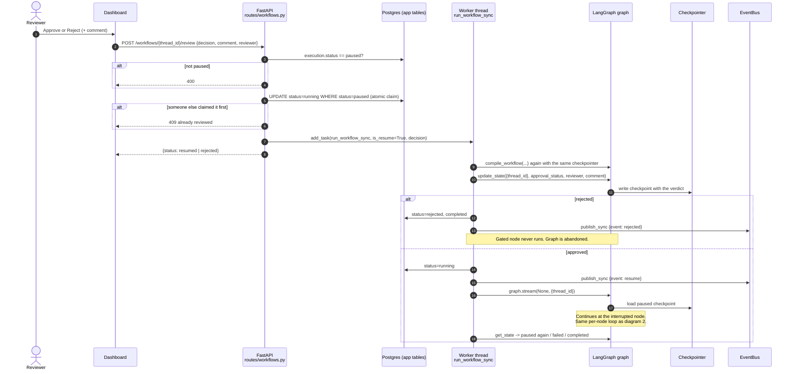

# CLI agent run: sequence diagrams

The path a workflow takes when its nodes use the `cli_agent` executor, from the
dashboard's Execute button to the Docker container and back. Renders on GitHub,
or paste a block into https://mermaid.live.

## 1. Startup (once per backend process)

## 2. Executing a workflow

## 3. Human review (HITL) and resume

## Where things live

| Concern | File |
| --- | --- |
| HTTP routes, worker, status bookkeeping | `backend/src/api/routes/workflows.py` |
| SSE endpoint | `backend/src/api/routes/events.py` |
| In-process pub/sub | `backend/src/engine/pubsub.py` |
| Workflow -> LangGraph compile, node dispatcher, edge conditions | `backend/src/engine/orchestrator.py` |
| Graph state shape | `backend/src/engine/state.py` |
| Postgres / memory checkpointer | `backend/src/engine/checkpointer.py` |
| Executor lookup by key | `backend/src/registry/executor_registry.py` |
| Runtime presets (image, command, env) | `backend/src/registry/runtime_registry.py`, `backend/config/runtimes.yaml` |
| CLI agent lifecycle | `backend/src/executors/cli_agent_executor.py` |
| Source checkout and copy | `backend/src/tools/git_fetcher.py` |
